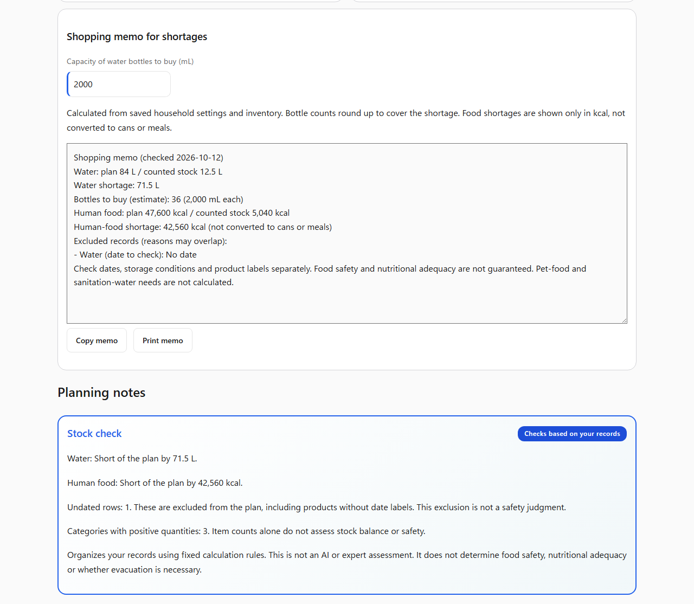
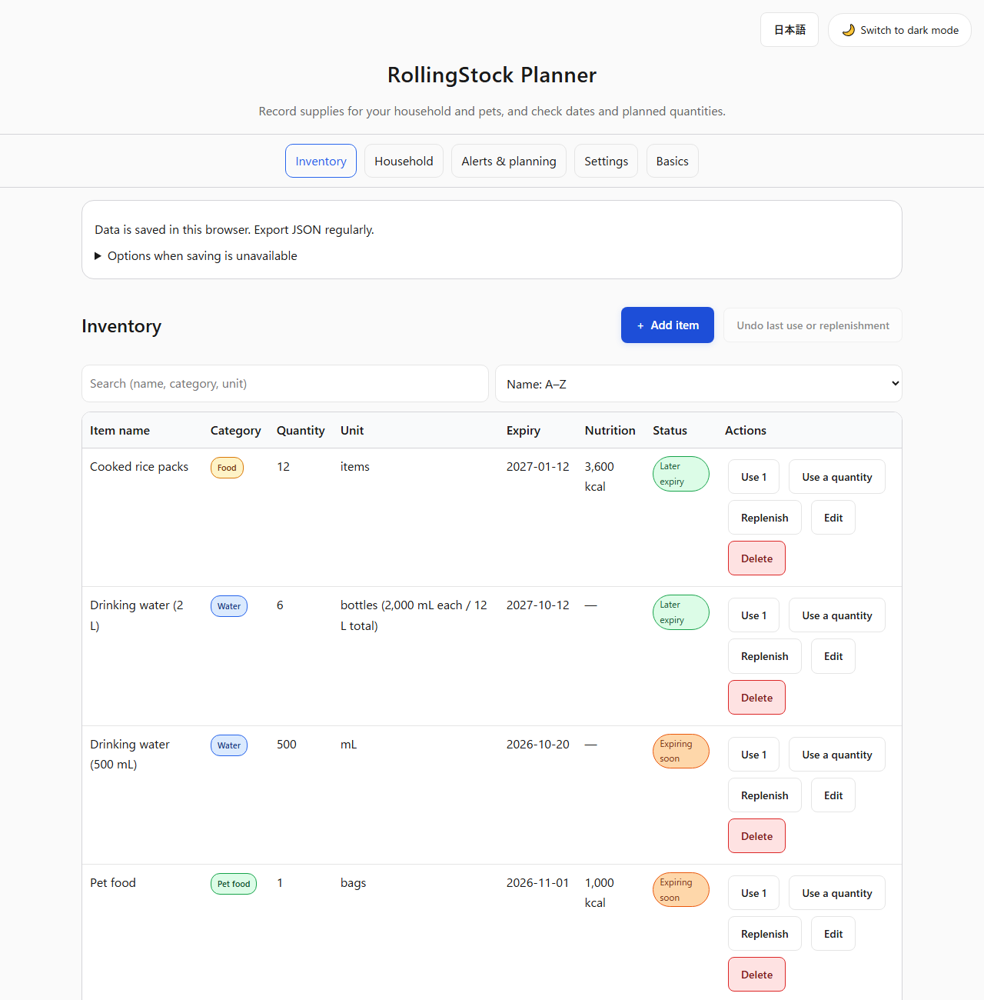
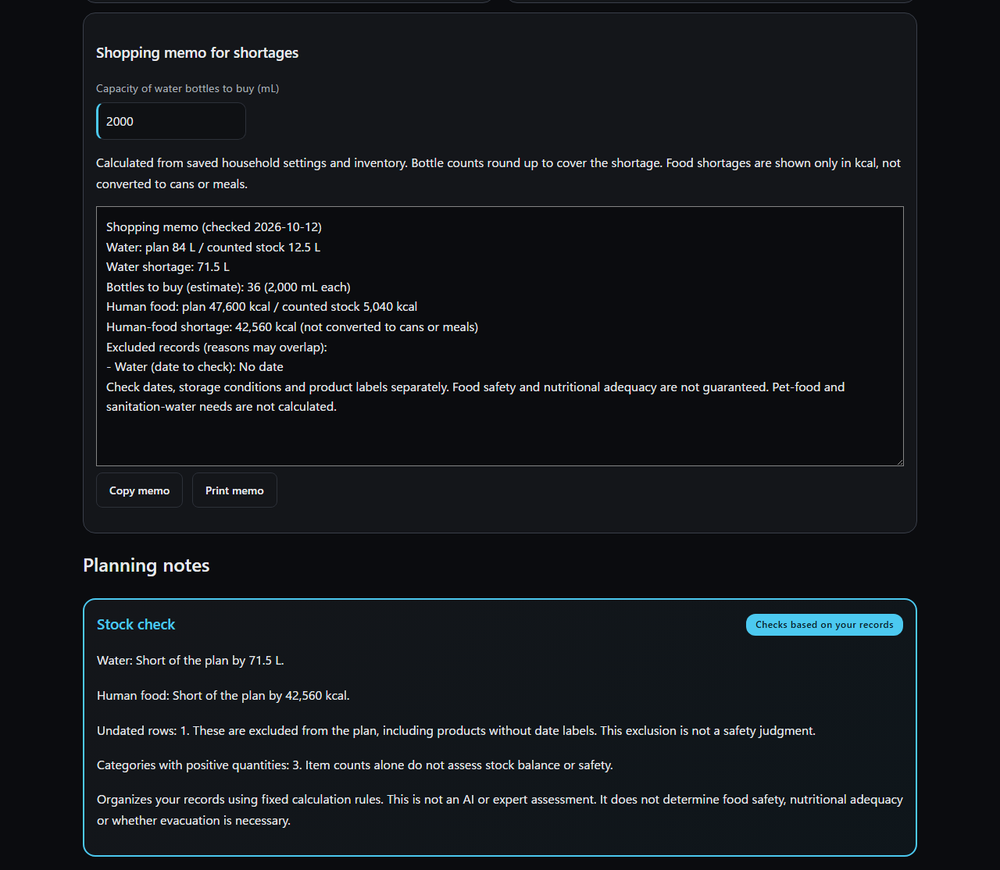

English · [日本語](README.md)

# RollingStock Planner - Disaster Preparedness Stock Management Tool


[](https://ipusiron.github.io/rollingstock-planner/)

**Day096 - 100 Security Tools with Generative AI**

RollingStock Planner supports stock rotation: using household supplies and replenishing what you use. Compare inventory with your household plan to check water and human-food shortages and expiry dates.

Checks are based on the values you enter. This is not an AI or expert assessment and does not guarantee food safety, nutritional adequacy or survival during a disaster.

---

## 🌐 Demo

👉 [Open RollingStock Planner](https://ipusiron.github.io/rollingstock-planner/)

Use it directly in your browser. The button at the top right switches between Japanese and English. The initial language follows the URL's `?lang=ja|en`, then your saved choice, then your browser language. Browsers using a language other than Japanese default to English.

---

## 📸 Screenshots

>
>
>*Stock check using example inputs prepared for screenshots, not real user data.*

>
>
>*Inventory. Register water as total volume, or as a bottle count and capacity per bottle.*

>
>
>*The same example inputs in dark mode.*

---

## 🚀 Main features

- Household planning: set counts and daily water and calories per person
- Separate water and human-food totals: water in L or mL; food as quantity × kcal per unit
- Date checks: distinguish expired, due today, expiring soon, later expiry and undated records
- Stock rotation: show food, water and pet food due today through 14 days from now
- Disaster education: 13 expandable sections
- Data management: browser storage and JSON export/import
- Display: light/dark themes, wrapping tabs, keyboard controls and 50-row pagination
- Quantity actions: use one unit or a specified quantity, replenish by expiry date, and undo the last action
- Bottled water: enter bottle count and capacity to display the total in L
- Shopping memo: water shortage in L, estimated bottles to buy, human-food shortage in kcal and excluded records; copy and print
- Bilingual interface: switch without losing unfinished input; user-entered names and units are not translated

---

## 🎯 Purpose and limitations

### 1. Checking stock rotation

Review foods with approaching dates instead of buying and forgetting them. Update records with Use 1, Use a quantity and Replenish. The tool does not detect actual consumption, place orders or deliver notifications.

Use 1 subtracts one of the row's units: 1 L for a quantity of 12 with unit L, or one bottle for a six-bottle record with capacity. Using more than the recorded quantity is rejected; zero-quantity rows remain. When replenishing, enter the date on the newly purchased supplies. Quantities are combined only if both dates are nonempty and match. A different or missing date creates a separate row without changing the original.

You can undo the most recent use or replenishment once. Saving another change or reloading clears undo. If saving fails, confirmed quantities are unchanged, and input and undo information are retained. These actions update records; they do not decide whether food or medicine should be used.

Rotation candidates are food, water and pet food with positive quantities and dates from today through 14 days ahead. Medicines and expired items are not recommended for consumption. Check the packaging, whether an item has been opened, its storage conditions and its label even when it appears on the list.

### 2. Numerical stock checks

Water and human-food calories are compared with their respective planning values. There is no combined score in which excess water offsets a food shortage.

Category figures count registered rows with positive quantities. They are not sums of mixed units such as 2 L of water plus three food items, nor measures of nutritional balance. Expired and undated items remain in inventory but are excluded from the plan. A date within range does not establish that food is safe to eat.

### 3. Household-based planning

The default water value is 3 L/person/day for every age group, intended for drinking and cooking. It excludes sanitation water for toilets and washing. Default calories are calculation examples: 2,000 kcal per adult, 1,400 per child and 1,800 per senior. Adjust them for age, body size, activity and any medical dietary restrictions.

Daily water per dog or cat starts unset. If you have that type of pet, overall water coverage is not shown until you set the value. Pet food is not added to human-food calories, and its required quantity is not calculated. Check product guidance and veterinary advice.

Available planning periods are 3, 7, 14, 30 and 180 days. Availability in the selector is not a recommendation for a particular stock duration.

### 4. Disaster education

Open the sections you need in the Basics tab.

- Basic approach: evacuation information, staying home and evacuation shelters
- Stock duration: planning and reviewing the number of days
- Stock rotation: use, replenishment and earliest-date-first checks
- Storage: distribution, temperature, humidity and flooding
- Nutrition: foods your household can eat and individual differences
- Dates: best-before and use-by dates, and storage conditions
- Cooking: water, fuel and equipment according to product instructions
- Pets: evacuation preparation and local acceptance rules
- Children and seniors: baby food, suitable food textures and medicines
- Seasons: preparing for heat and cold
- Ethical dilemmas: mutual help and household supplies
- Tool tips: entering calories and water, updating household settings and backups
- Mistakes: missed dates, missing equipment and concentrated storage locations

Follow current municipal information, product labels and instructions from medical or veterinary professionals first.

### 5. Browser storage

The application contains no operation that sends inventory to a server. Opening the public page still involves network traffic. Stored data and exported JSON are not encrypted and may be readable by people with access to the same device/browser or by scripts on the same origin.

Save all required files locally to open the tool without a network. Offline caching of the public page and synchronization between devices are not implemented. Keep JSON backups elsewhere in case browser data is cleared or storage is restricted.

### 6. Long-term planning

You can calculate planning values for up to 180 days. This does not establish safe long-term storage or show that every necessary supply is covered. Check expiry dates, available space, storage conditions and quantities you can realistically use separately.

---

## 👥 Intended users

The tool is intended for:

- Households preparing for disasters
  Individuals and families managing supplies and rotating them regularly

- People living with pets
  Owners recording pet supplies in the same inventory and choosing their own water planning values

- Families with young children
  Families checking suitable foods and planning values for their children

- People caring for seniors
  Families recording food and supplies while separately following medical and care instructions

- People living alone
  Single-person households starting with basic supplies or making a personal stock plan

- Preppers
  People managing longer-term supplies and preparing for different scenarios

- Disaster-preparedness educators
  Teachers and instructors using the tool in schools, vocational schools or community courses

- Community disaster-preparedness groups
  Members supporting local awareness or planning shared supplies

- Corporate administration and crisis-management staff
  Staff planning office supplies or raising employees' preparedness awareness

---

## 🎯 Use cases

### Uses specific to this tool

These are example inputs, not evidence of real-world use or measured effectiveness.

| Question | Example input | What you can check |
|---|---|---|
| How much water is recorded in mixed mL and L units? | 500 mL and 12 L of water, both within their dates | Water counted toward the plan is 12.5 L |
| Why is the plan short even though stock exists? | 12 L of dated water and 12 L without a date | Inventory totals 24 L, but only 12 L counts toward the plan; investigate the missing date |
| Could a weekend check miss an expiry? | Food due today and food due in 15 days | Only the first is included in the today-through-14-days list |
| Can pet food be kept separate from human food? | Human food at 300 kcal × 2 bags and pet food at 1,000 kcal × 1 bag | Human food totals 600 kcal; pet food is recorded separately |

### Scenario 1: Reviewing longer-term stock

Register items individually and set the warning threshold to 3 months. After using an approaching-date item in a meal, record it with Use a quantity; enter the quantity and date of new supplies with Replenish. Change the period to 14, 30 or 180 days and save to see how the plan changes for the same inventory.

These operations do not assess nutritional balance, storage-location safety or whether your family can eat the food.

### Scenario 2: Stock rotation for a family of four

1. Save 2 adults, 2 children and 7 days, with 3 L/person/day, 2,000 kcal/adult and 1,400 kcal/child.
2. Check the targets: water 84 L and human food 47,600 kcal.
3. Register six 2 L bottles as Water, Bottle count and capacity, quantity 6, capacity 2000 mL. Total-volume entry with quantity 12 and unit L also represents 12 L. Enter food quantities and kcal per unit.
4. Enter dates and check 12 L counted water and a shortage of 72 L.
5. Check dates weekly and update quantities after use and replenishment.

Days and calorie values are examples. Cost, registration time and reduction in waste have not been measured.

Using one of six capacity-defined bottles leaves five bottles, or 10 L. Bottle counts are never inferred from total-L records. Bottle mode accepts whole-number counts and capacities from 1 to 1,000,000 mL in whole mL. When changing entry methods, also check quantity and unit against the actual supplies.

The shopping memo in Alerts & planning shows 36 bottles of 2,000 mL or 144 bottles of 500 mL for a 72 L shortage. Counts round up. No bottle count is calculated when the water target is zero or unset. Food is shown only as missing kcal, not converted to cans or meals.

The memo uses saved household settings and inventory. It lists water and food excluded because of expiry, missing dates, unknown volume or missing calories, with reasons. If copying fails, select and copy the text manually. Printing outputs only the memo. The purchase-bottle capacity is not saved and returns to 2,000 mL on reload.

### Scenario 3: A community preparedness workshop

Use invented household and inventory examples instead of participants' personal data. Add undated water to compare inventory totals with the amount counted toward the plan. Use the Basics tab to discuss local evacuation information and preparing to evacuate with pets.

Do not put personal information into JSON or browser storage on a shared device. Collaborative editing and access-control management are not supported.

---

## 🗂️ Tabs

| Tab | Features |
|---|---|
| Inventory | Add, edit, delete, use, replenish, one-step undo, search, sort, 50-row pages, inventory totals and counted amounts |
| Household | People, pets, days and daily planning values per person or pet |
| Alerts & planning | Expired/expiring items, today-through-14-days rotation candidates, separate water and human-food coverage and shortages, shopping memo |
| Settings | Warning threshold of 1, 2, 3 or 6 months, JSON import/export, delete all items |
| Basics | 13 educational sections and links to official sources |

---

## 📊 Expiry statuses and rules

Dated inventory has four statuses; undated records have a separate status.

| Badge | Condition | What to check |
|---|---|---|
| Expired | Yesterday or earlier | Excluded from the plan. Do not eat food past its use-by date |
| Due today | Date is today | Check the label's date type and storage conditions |
| Expiring soon | Tomorrow through the warning-threshold date | Plan consumption or replacement |
| Later expiry | After the warning-threshold date | Not a food-safety judgment; check storage conditions too |
| No date | Date field is empty | Excluded from the plan. Check the actual label |

Dates are compared as local calendar dates on the device. Adding months clamps to the destination month's last day: one month after January 31 is February 28, or 29 in a leap year. Nonexistent dates are rejected.

Past dates can be recorded, but expired and undated inventory is excluded from the plan. Zero-quantity rows remain but are excluded from totals, alerts and category row counts. When the date changes while the page is open, results refresh approximately once a minute or when you return to the page.

## 💾 Storage and JSON backups

- Inventory, household and warning threshold are saved together. Failed saves do not replace confirmed in-memory data
- Imports are limited to 10 MiB and 5,000 rows. Every row is validated, then data is replaced after confirmation
- Invalid rows are not silently dropped, and categories or numbers are not automatically corrected
- Unavailable storage switches to a temporary session only when chosen by the user. Export JSON because reloading loses temporary changes
- Corrupt saved data is not overwritten on load; use Rescue raw data to retrieve it
- Detected changes from another tab stop saving. Keep a copy of your input and reload. This is not a complete concurrent-editing lock

Import replaces data; it does not append. Export JSON first. Rescue raw data produces a diagnostic/recovery file, not the regular import format.

LocalStorage capacity varies by browser. A file within the import limit may still be too large to save. HTTPS, local HTTP and directly opened files use different storage locations; storage behavior for local files also depends on the browser.

The storage key is `rsp_state_v2`; its internal format and regular JSON output use `meta.ver: 3`. Capacity-defined water retains `unit: "bottle"` and `volumeMl`. Formats 1, 2 and 3 can be read; unsupported versions are rejected. Compatibility keys such as `rsp_items` remain read-only. Language (`rsp_language`) and theme (`rsp_theme`) are saved independently and are not part of JSON backups.

---

## 🍱 Basic emergency supplies

Use this list to consider what to prepare. Review it for your destination, household circumstances and local guidance.

| Category | What to check |
|---|---|
| Water | Plan around 3 L/person/day for drinking and cooking; prepare sanitation water separately |
| Food | Familiar foods, heating/water requirements, allergies and therapeutic diets |
| Medicines | Medicines and medication records; ask a doctor or pharmacist about reserve amounts and storage |
| Information and lighting | Radio, flashlight, charging options and spare batteries |
| Daily supplies | Portable toilets, hygiene supplies, menstrual products and other necessities |
| Documents and contacts | Necessary copies and emergency contacts, stored against loss and disclosure |
| Cash | Preparation for payment outages caused by power or network failure |
| Pet supplies | Food, water, toileting supplies, medicines and carriers; check individual needs |
| Evacuation plan | Routes, destinations and ways to contact family |

A best-before date concerns quality when the product is unopened and stored as directed. Appearance or smell alone cannot establish safety. Do not eat food past its use-by date. Consult the official sources below for details.

---

## ⚖️ Ethical dilemmas and action guidelines

> Q: What if a neighbor asks for food?
> A: Prioritize survival needs for yourself and your family. Community cooperation can also be lifesaving.
> Consider options beyond simply sharing or refusing, such as shared cooking or information exchange.

> Q: What about pets at a shelter?
> A: Check your municipality's website in advance for rules on evacuation with pets. Pack pet food, water and medicines in the emergency bag.

> Q: Should I stay home or evacuate?
> A: Do not decide from stock duration alone. Check municipal evacuation information and current hazards. Evacuate early from dangerous places.

---

## 💾 Technical specifications

- Frontend: HTML, CSS and vanilla JavaScript; no build or external libraries
- Storage: LocalStorage, with an explicitly selected tab-only temporary session
- Displays: category row counts, water and human-food amounts and coverage, HTML progress bars
- Validation: finite nonnegative numbers, real dates, categories, household counts, row and text-length limits
- XSS safeguards: text output, HTML escaping and category allowlist
- CSP: a meta policy that denies external scripts, connections and form submissions
- JSON: replacement after full validation, up to 10 MiB and 5,000 rows
- Checked: Chromium and Firefox, local files and local HTTP, widths of 320, 390, 800 and 1280 px

CSP does not prevent every attack. This repository provides no mechanism to set arbitrary HTTP response headers on GitHub Pages. Encryption, tamper detection and user authentication are not implemented.

---

## 🔧 Developer information

Calculation, date and storage specifications are in [TECHNICAL.md](TECHNICAL.md) (Japanese).

Save the complete file set and open index.html directly, or run this from the project root:

```sh
python -m http.server 8000
```

Open the local server at http://localhost:8000/. No dependency installation is needed. Run tests with Node.js 22:

```sh
npm test
```

GitHub Actions also runs tests for both push and pull_request. Tests check calculations and input/storage protections; they do not demonstrate the effectiveness of disaster-preparedness advice.

---

## 🔗 Related knowledge

- [MAFF: Household food stocks](https://www.maff.go.jp/j/zyukyu/foodstock/imadoki/imadoki02_10.html) (Japanese): preparing water and food
- [Consumer Affairs Agency: Emergency food stocks](https://www.caa.go.jp/policies/policy/consumer_policy/information/food_loss/efforts/stockpile/) (Japanese): stock rotation
- [FDA: Food and water safety during power outages and floods](https://www.fda.gov/food/buy-store-serve-safe-food/food-and-water-safety-during-power-outages-and-floods): handling refrigerated food during outages
- [Ministry of the Environment: Dog and cat microchip registration Q&A](https://www.env.go.jp/nature/dobutsu/aigo/pickup/chip_qa.html) (Japanese): coverage and procedures of Japan's registration system

---

## 📘 Educational uses

- Disaster-preparedness classes in high schools and vocational schools
- Materials for municipal courses and preparedness instructors
- Practical simulations in family discussions and community drills

---

## 📁 Directory structure

```text
rollingstock-planner/
├── index.html          # Main HTML (single-page application)
├── script.js           # UI events and rendering
├── stock-core.js       # Dates, totals and validation
├── stock-actions.js    # Use, replenish, undo and shortage bottle counts
├── stock-store.js      # Persistence, conflict detection and recovery
├── messages.js         # Japanese and English interface messages
├── i18n.js             # Language selection and interface binding
├── theme-init.js       # Theme before rendering
├── package.json        # Dependency-free test command
├── test/               # Calculation, storage and UI regression tests
├── .github/
│   └── workflows/
│       └── test.yml    # Automated push and PR tests
├── style.css           # Light/dark and responsive styles
├── assets/             # Images
│   ├── screenshot.png  # Stock check
│   ├── screenshot2.png # Inventory
│   ├── screenshot3.png # Stock check (dark)
│   └── en/             # Three English screenshots in the same states
├── README.md           # Japanese project documentation
├── README.en.md        # Complete English version
├── TECHNICAL.md        # Technical details for developers (Japanese)
├── CLAUDE.md           # Coding-agent guide
├── LICENSE             # MIT license
├── .gitignore          # Git exclusions
└── .nojekyll           # GitHub Pages setting
```

---

## 📄 License

MIT License. See [LICENSE](LICENSE) for details.

---

## 🛠️ About this tool

This tool was developed as part of the "100 Security Tools with Generative AI" project.
The project uses AI assistance to create and publish security-related tools over 100 days.

For project details and other tools, visit:

🔗 [Project overview](https://akademeia.info/?page_id=42163)
