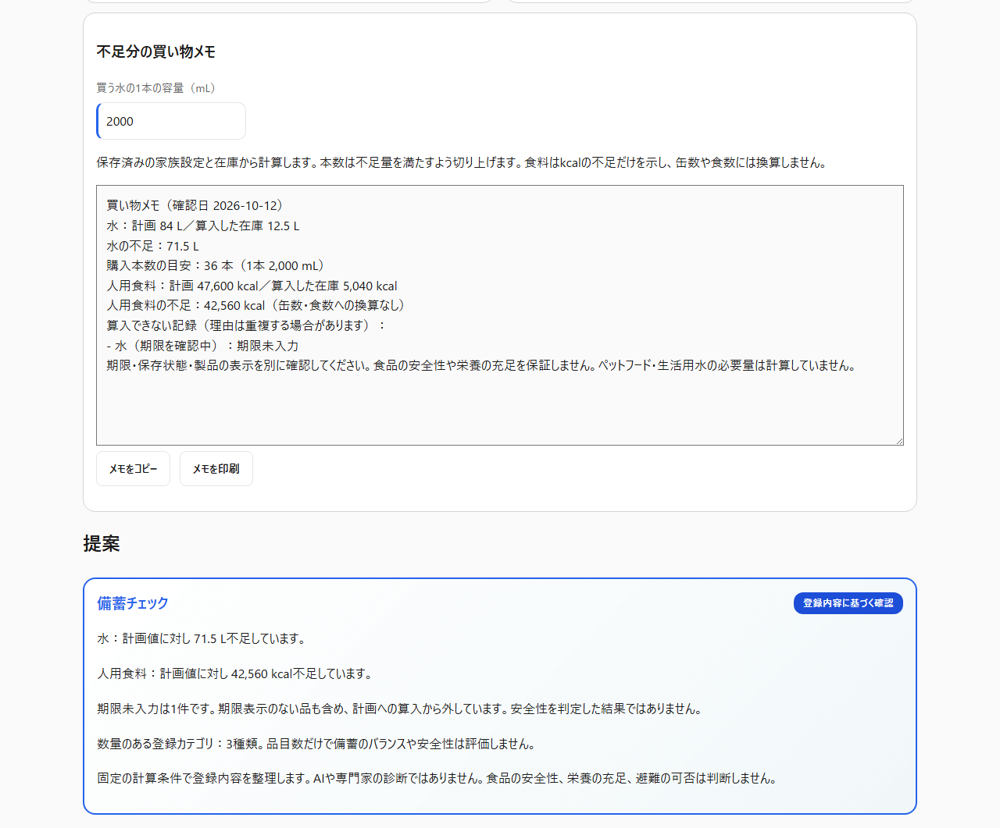
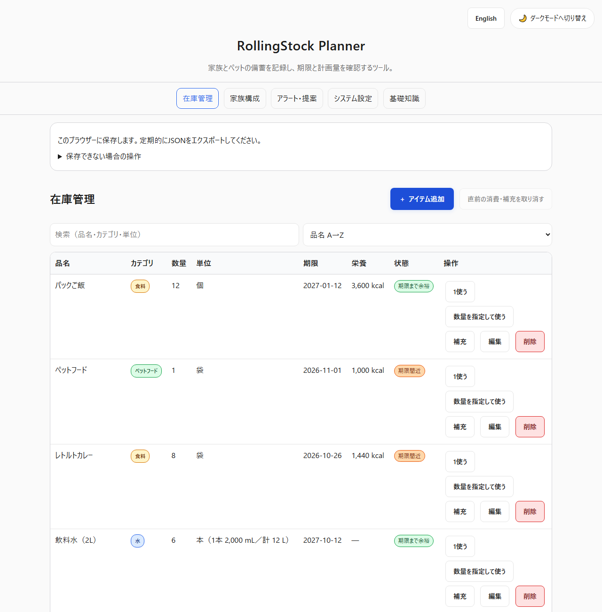
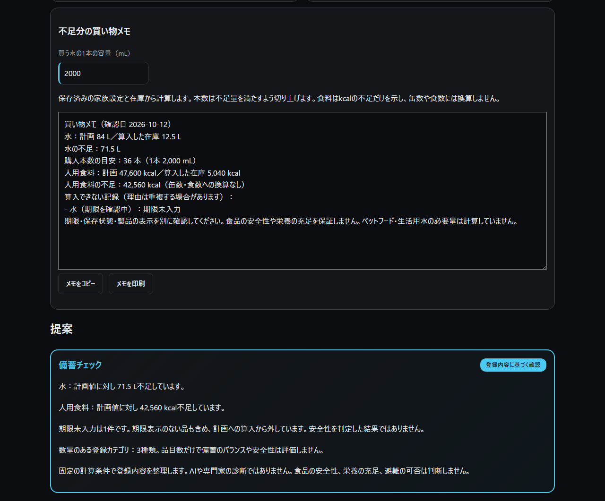

<!--
---
id: day096
slug: rollingstock-planner

title: "RollingStock Planner"

subtitle_ja: "防災備蓄管理ツール"
subtitle_en: "Disaster Preparedness Stock Management Tool"

description_ja: "家庭の備蓄品・期限と家族ごとの計画値をブラウザー内で管理するツール。水量と人用食料のカロリーを別々に集計し、集計できない在庫や未設定値も表示します。13節の防災学習コンテンツとJSONバックアップに対応します。"
description_en: "A browser-based household stock planner with expiration tracking, separate water and human-food calorie totals, configurable planning values, and explicit unknown values. Includes 13 disaster-preparedness learning sections and JSON backup."

category_ja:
  - サバイバル
  - 防災
  - プレッパー
category_en:
  - Survival
  - Disaster Preparedness
  - Prepper

difficulty: 2

tags:
  - disaster-preparedness
  - survival
  - stock-management
  - rolling-stock
  - javascript
  - education
  - prepper
  - dark-mode
  - security
  - xss-protection
  - localstorage

repo_url: "https://github.com/ipusiron/rollingstock-planner"
demo_url: "https://ipusiron.github.io/rollingstock-planner/"

hub: true
---
-->

# RollingStock Planner - 防災備蓄管理ツール


[](https://ipusiron.github.io/rollingstock-planner/)

**Day096 - 生成AIで作るセキュリティツール100**

RollingStock Plannerは、備蓄品を消費しながら補充する「ローリングストック」を支援するツールです。家族の計画値と在庫を比べ、水と人用食料の不足量、期限を確認できます。

計算は登録した値に基づく備蓄チェックです。AIや専門家による診断ではなく、食品の安全性、栄養の充足、災害時の生存を保証しません。

---

## 🌐 デモページ

👉 [https://ipusiron.github.io/rollingstock-planner/](https://ipusiron.github.io/rollingstock-planner/)

ブラウザーで直接お試しいただけます。

---

## 📸 スクリーンショット

>
>
>*備蓄チェック。撮影用の入力例であり、実際の利用者のデータではありません。*

>
>
>*在庫一覧。水は容量をLまたはmLで登録します。*

>
>
>*同じ入力例をダークモードで表示。*

---

## 🚀 主な特長

- 家族構成別の計画：人数と1人1日あたりの水量・カロリーを設定
- 水と人用食料の別集計：水はL・mL、人用食料は数量×1単位あたりのkcal
- 期限の確認：期限切れ・本日期限・期限間近・期限まで余裕・期限未入力を区別
- ローリングストック支援：今日から14日後までに期限を迎える食料・水・ペットフードを表示
- 防災学習：13節の基礎知識をアコーディオンで参照
- データ管理：ブラウザー内保存、JSONエクスポート／インポート
- 表示：ライト／ダーク、折り返すタブ、キーボード操作、50件単位のページ切り替え

---

## 🎯 本ツールの役割と限界

### 1. ローリングストックの確認

「買って放置」しないために、期限の近い食品を一覧で確認します。消費・補充したときは在庫の数量を編集してください。数量の自動減算、購入リストの自動発注、通知の配信は行いません。

消費候補は数量が正で、期限が今日から14日後までの食料・水・ペットフードです。医薬品や期限切れの品を「消費するもの」として勧めません。表示された食品も、開封状態・保存方法・商品の表示を確認してください。

### 2. 数値に基づく備蓄チェック

水量と人用食料のカロリーを、それぞれの計画値と比較します。水の過剰分で食料不足を相殺する総合点は付けません。

カテゴリ別の数値は数量が正の登録行数です。「水2L」と「食料3個」を足した量や栄養バランスを表すものではありません。期限切れ・期限未入力の品は台帳に残しますが、計画への算入から外します。期限の範囲内でも食べられるかどうかは判定できません。

### 3. 家族構成ベースの計画

水の初期値は年齢区分によらず1人1日3Lです。飲料・調理用の目安であり、トイレや洗浄などの生活用水は含みません。カロリーは成人2,000、子ども1,400、高齢者1,800kcalを入力例として設定しています。個人の年齢・体格・活動量や療養上の制限に合う値へ変更してください。

犬・猫の1匹1日あたりの水量は未設定です。該当するペットがいる場合、その値を設定するまで合計水量の達成率は出しません。ペットフードは人用食料に加算せず、必要量も計算しません。商品の案内や獣医師の助言を確認してください。

想定日数は3・7・14・30・180日です。選べる日数は備蓄期間の推奨ではありません。

### 4. 防災学習

基礎知識タブでは、必要な節を開いて参照できます。

- 基本方針：避難情報、在宅避難と避難所避難
- 備蓄期間：日数ごとの計画と見直し
- ローリングストック：消費と補充、期限の早い順での確認
- 保管場所：分散、温度・湿度、浸水への備え
- 栄養：食べられる食品の選定と個人差
- 期限：賞味期限と消費期限、保存条件
- 調理：製品表示に沿った水・燃料・器具の使用
- ペット：同行避難の準備と自治体ごとの受け入れ条件
- 子ども・高齢者：離乳食、介護食、薬の備え
- 季節：暑さ・寒さに応じた準備
- 倫理的ジレンマ：助け合いと家族の備え
- 災害シナリオ：地震・水害・停電など
- 失敗例：期限の見落とし、道具不足、保管場所の偏り

自治体の最新情報、製品表示、医療・獣医療の専門家の指示を優先してください。

### 5. ブラウザー内保存

在庫データをアプリからサーバーへ送信する処理はありません。ただし、公開ページを開く通信は発生します。保存内容と出力JSONは暗号化されず、同じ端末・ブラウザーを使える人や同一オリジンのスクリプトから読まれ得ます。

ローカルに必要なファイル一式を保存すれば、ネットワークなしで開けます。公開ページのオフラインキャッシュや複数端末間の同期は実装していません。ブラウザーのデータ消去や保存制限に備えて、JSONを別の場所に保管してください。

### 6. 長期計画

180日までの計画値を試算できますが、長期保管の安全性や、すべての生活物資が足りることを示すものではありません。物資の期限、置き場所、保管条件、消費できる量を別途確認してください。

---

## 👥 対象ユーザー

このツールは、以下のような方々を対象としています：

- 家庭で防災対策をしている方
  日常的に備蓄を管理し、ローリングストックを実践したい個人・家族

- ペットと暮らしている方
  ペット用品も同じ台帳で管理し、水の計画値を自分で設定したい飼い主

- 小さな子どもがいる家庭
  子どもに合った食品と計画値を確認しながら備蓄したい家族

- 高齢者を介護している方
  医療・介護上の指示を別途確認し、食品や用品を記録したい介護家族

- 一人暮らしの方
  最小限の備蓄から始めたい単身世帯や、自分専用の備蓄計画を立てたい方

- プレッパー（備蓄愛好家）
  長期的な備蓄を計画的に管理し、様々なシナリオに備えたい実践者

- 防災教育に関わる方
  学校・専門学校での防災授業や、地域の防災講習で使用したい教育者・防災士

- 自主防災組織のメンバー
  地域の防災啓発活動や、共同備蓄の計画立案に活用したい方

- 企業の総務・危機管理担当者
  オフィスや事業所での備蓄管理、従業員の防災意識向上に役立てたい方

---

## 🎯 ユースケース

### このツールならではの使い方

以下は入力例であり、利用実績や効果の測定結果ではありません。

| 問い | 入力例 | 確認できること |
|---|---|---|
| 500mLとLを混ぜた備蓄はいくらか | 水500mLと水12L、いずれも期限内 | 計画に算入する水量は12.5L |
| 在庫はあるのに計画に足りないのはなぜか | 期限内の水12Lと期限未入力の水12L | 台帳は24L、計画への算入は12L。未入力の期限を調べるきっかけ |
| 週末の点検で見落とす期限はないか | 本日期限の食品と、15日後が期限の食品 | 今日から14日後までの候補には前者だけが入り、今日の分を見落とさない |
| ペット用と人用を分けて数えられるか | 人用食料300kcal×2袋、ペットフード1,000kcal×1袋 | 人用食料は600kcal。ペットフードは混ぜずに記録 |

### シナリオ1：長期備蓄の見直し

在庫を1件ずつ登録し、警告閾値を3カ月に設定します。期限の近い品を食事に使ったら数量を編集し、補充後も更新します。日数を14・30・180日と切り替えると、同じ在庫に対する計画値の変化を確認できます。

この操作だけでは、食料の栄養バランス、保管場所の安全性、家族が食べられるかどうかは確認できません。

### シナリオ2：4人家族のローリングストック入門

1. 成人2人・子ども2人・7日、1人1日3L、成人2,000kcal・子ども1,400kcalを保存。
2. 計画値の水84L、人用食料47,600kcalを確認。
3. 水2Lボトル6本を「水・数量12・単位L」、食料を数量と1単位あたりのkcalで登録。
4. 期限を入力し、水の計画算入量12L・不足72Lを確認。
5. 週ごとに期限を確認し、消費・補充した数量を更新。

日数やカロリーの設定値は例です。費用、登録時間、廃棄の削減率は測定していません。

### シナリオ3：地域の防災講習

参加者の実データを使わず、講習用の家族構成と在庫を登録します。期限未入力の水を加えて、台帳と計画に算入する量の違いを確かめます。基礎知識タブを使い、自治体の避難情報や、ペットとの避難準備を話し合えます。

共用端末のJSONや保存データには個人情報を入れないでください。共同編集やアクセス権の管理には対応していません。

---

## 🗂️ タブ構成

| タブ名 | 機能概要 |
|---|---|
| 在庫管理 | 登録・編集・削除、検索・並べ替え、50件ごとの一覧、台帳集計と計画算入量 |
| 家族構成 | 人数・ペット数・日数・1人／1匹1日あたりの計画値 |
| アラート・提案 | 期限切れ／期限間近、今日から14日後までの消費候補、水と人用食料の達成率・不足量 |
| システム設定 | 警告閾値1・2・3・6カ月、JSONの入出力、全アイテム削除 |
| 基礎知識 | 13節の防災学習コンテンツと公式資料へのリンク |

---

## 📊 期限ステータスの種類と判定ロジック

期限のある在庫は4段階、期限未入力は別の状態で表示します。

| バッジ | 判定条件 | 確認すること |
|---|---|---|
| 期限切れ | 期限日が昨日以前 | 計画から除外。消費期限を過ぎた食品は食べない |
| 本日期限 | 期限日が今日 | 製品の期限の種類と保存条件を確認 |
| 期限間近 | 明日以降、警告閾値の日まで | 消費や交換の計画を立てる |
| 期限まで余裕 | 警告閾値の日より後 | 食品の安全を意味せず、保存状態も別途確認 |
| 期限未入力 | 期限の欄が空 | 計画から除外。現物の表示を確認 |

日付は端末のローカル暦日で比較します。月末からの月数加算は移動先の月末までとし、1月31日の1カ月後は2月28日（うるう年は29日）です。存在しない日付は受け付けません。

過去の日付も記録できますが、期限切れ・期限未入力の在庫は計画に算入しません。数量0の行は残りますが、集計・アラート・カテゴリ別登録行数から外します。画面を開いたまま日付が変わった場合、約1分ごと、または画面への復帰時に更新します。

## 💾 保存とJSONバックアップ

- 在庫・家族構成・警告閾値はまとめて保存。保存に失敗したときは画面内の確定済みデータを置き換えない
- インポートは最大10MiB・5,000件。全件を検証し、確認後に現在のデータを置換
- 不正な行を黙って捨てたり、カテゴリや数値を勝手に補正したりしない
- 保存領域が使えない場合は、利用者が選んだときだけ一時利用に切り替え。一時利用中は再読込で消えるためJSON保存が必要
- 壊れた保存データを読み込んだ場合は、元データを上書きせず「元データを救出」で取得
- 別タブの変更を検出したら保存を停止。入力を控えて再読込が必要。同時編集の完全な排他制御ではない

インポートは追記ではありません。先にJSONをエクスポートしてください。「元データを救出」のファイルは調査・復旧用で、通常のインポート用JSONとは形式が異なります。

LocalStorageの容量はブラウザーによって異なります。上限以内のファイルでも保存できるとは限りません。HTTPS、ローカルHTTP、直接開いたファイルでは保存先が異なり、ファイルを直接開いた場合の保存挙動はブラウザーにも依存します。

---

## 🍱 基本的な防災セット

以下は準備する物を考えるための一覧です。避難先・家族の事情・自治体の案内に合わせて見直してください。

| カテゴリ | 確認する内容 |
|---|---|
| 水 | 飲料・調理用として1人1日3Lを目安に計画。生活用水は別途用意 |
| 食料 | 食べ慣れた食品、加熱や水が必要か、アレルギーや療養食 |
| 医薬品 | 薬とお薬手帳。予備の量や保管は医師・薬剤師に相談 |
| 情報手段 | ラジオ、懐中電灯、充電手段、予備電池 |
| 生活用品 | 携帯トイレ、衛生用品、生理用品など |
| 書類・連絡先 | 必要な写しと緊急連絡先。紛失・漏洩しない保管方法 |
| 現金 | 停電や通信障害で決済手段が使えない場合の備え |
| ペット用品 | 食料・水・排泄用品・薬・キャリー。必要量は個体ごとに確認 |
| 避難計画 | 避難経路、避難先、家族の連絡方法 |

食品の賞味期限は、表示された条件で未開封のまま保存した場合の品質の目安です。外観や臭いだけで安全とは判断できません。消費期限を過ぎた食品は食べないでください。詳しくは下記の公式資料を確認してください。

---

## ⚖️ 倫理的ジレンマと行動指針

> Q：隣人に食料を求められたら？
> A：まず自分と家族の生命維持を優先する。しかし、地域の連携が生死を分ける場合もある。
> 単なる「分け与える／拒む」二択ではなく、共同調理・情報共有 などの中間的選択肢も視野に。

> Q：避難所でペットはどうする？
> A：同行避難の可否を自治体サイトで事前確認。避難バッグにペット食料・水・医薬品を同梱。

> Q：籠城と避難、どちらを選ぶ？
> A：備蓄の日数だけで決めず、自治体の避難情報と現在の危険を確認します。危険な場所では早めに避難してください。

---

## 💾 技術仕様

- フロントエンド：HTML／CSS／Vanilla JavaScript。ビルド・外部ライブラリー不要
- 保存：LocalStorage。任意でタブ内だけの一時利用
- 表示：カテゴリ別の登録行数、水と人用食料の数量・達成率、HTMLの進捗バー
- 入力検証：有限の非負数、実在する日付、カテゴリ、人数、件数・文字数の上限
- XSS対策：テキスト出力とHTMLエスケープ、カテゴリの許可リスト
- CSP：外部スクリプト・通信・フォーム送信を許可しないmetaポリシー
- JSON：全件検証後に置換、最大10MiB・5,000件
- 動作確認：Chromium／Firefox、ファイル直接表示とローカルHTTP、320・390・800・1280px

CSPだけですべての攻撃を防げるわけではありません。GitHub Pagesで任意のHTTPレスポンスヘッダーを設定する仕組みはこのリポジトリに含みません。暗号化、改ざん検出、利用者認証も実装していません。

---

## 🔧 開発者向け情報

計算・日付・保存の仕様は[TECHNICAL.md](TECHNICAL.md)に記載しています。

ファイル一式を保存してindex.htmlを直接開くか、プロジェクトルートで次を実行してください。

```sh
python -m http.server 8000
```

ローカルサーバーはhttp://localhost:8000/で開けます。依存パッケージのインストールは不要です。Node.js 22で次のテストを実行できます。

```sh
npm test
```

GitHub Actionsでもpushとpull_requestの両方でテストします。テストは計算と入力・保存の保護を検証するもので、防災助言の有効性を実証するものではありません。

---

## 🔗 関連知識

- [農林水産省：家庭での食料品備蓄](https://www.maff.go.jp/j/zyukyu/foodstock/imadoki/imadoki02_10.html)：水や食料の備え
- [消費者庁：災害に備えた食品ストック](https://www.caa.go.jp/policies/policy/consumer_policy/information/food_loss/efforts/stockpile/)：ローリングストック
- [FDA：停電・洪水時の食品と水の安全](https://www.fda.gov/food/buy-store-serve-safe-food/food-and-water-safety-during-power-outages-and-floods)：停電時の冷蔵品の扱い
- [環境省：犬と猫のマイクロチップ情報登録Q&A](https://www.env.go.jp/nature/dobutsu/aigo/pickup/chip_qa.html)：登録制度の対象と手続き

---

## 📘 教育活用例

- 高校・専門学校での防災教育授業
- 自治体や防災士講習の教材
- 家族会議や地域防災訓練での実践シミュレーター

---

## 📁 ディレクトリー構造

```
rollingstock-planner/
├── index.html          # メインHTML（シングルページアプリ）
├── script.js           # 画面操作・描画
├── stock-core.js       # 日付・集計・入力検証
├── stock-store.js      # 保存・競合検出・復旧
├── theme-init.js       # 描画前のテーマ適用
├── package.json        # 依存なしのテスト実行
├── test/               # 計算・保存・画面構造の回帰テスト
├── .github/
│   └── workflows/
│       └── test.yml    # push・PRの自動テスト
├── style.css           # スタイルシート（ダーク/ライトモード・レスポンシブ対応）
├── assets/             # 画像・アイコン類
│   ├── screenshot.png  # 備蓄チェック
│   ├── screenshot2.png # 在庫一覧
│   └── screenshot3.png # 備蓄チェック（ダーク）
├── README.md           # プロジェクト説明
├── TECHNICAL.md        # 技術詳細ドキュメント（開発者向け）
├── CLAUDE.md           # Claude Code向けガイド
├── LICENSE             # MITライセンス
├── .gitignore          # Git除外設定
└── .nojekyll           # GitHub Pages設定
```

---

## 📄 ライセンス

MIT License – 詳細は [LICENSE](LICENSE) を参照してください。

---

## 🛠️ このツールについて

本ツールは、「生成AIで作るセキュリティツール100」プロジェクトの一環として開発されました。
このプロジェクトでは、AIの支援を活用しながら、セキュリティに関連するさまざまなツールを100日間にわたり制作・公開していく取り組みを行っています。

プロジェクトの詳細や他のツールについては、以下のページをご覧ください。

🔗 [https://akademeia.info/?page_id=42163](https://akademeia.info/?page_id=42163)
